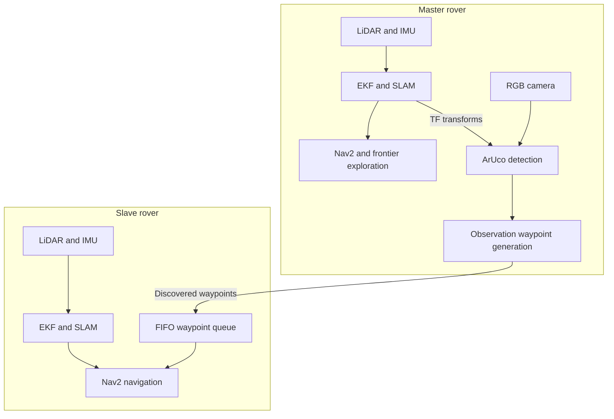

# Cooperative Multi-Rover Exploration with ROS 2

**Two autonomous rovers, independent navigation stacks, and ArUco-based waypoint sharing.**

An Intelligent Robotics university project by **Gennaro D'Alessio** and **Mariateresa Ciuoffi**, completed in **June 2025**.

**Technologies:** ROS 2 Humble, Gazebo / Ignition Fortress, Nav2, SLAM Toolbox, robot_localization, ArUco, Python, C++, and Docker.

## Overview

This project extends an existing single-rover simulation into a cooperative two-robot system. A **master rover** autonomously explores an environment and detects ArUco markers. A **slave rover** receives the discovered observation waypoints and navigates to them using its own navigation stack.

The main contribution is the integration of perception, state estimation, exploration, and navigation in a ROS 2 architecture with separate robot namespaces and TF frames. Cooperation is implemented through task-level waypoint communication.

The simulation is inspired by planetary rover exploration. The supplied scenario uses a planar maze and Earth gravity; it does not reproduce lunar terrain or gravity.

**Project status:** academic simulation prototype. The project report documents qualitative validation in Gazebo and RViz. The supplied code snapshot retains experimental variants and known integration issues; a clean rebuild and full mission have not been revalidated for this documentation release.

## Main contributions

- Extended the single-rover setup to spawn and operate two robots in the same simulated world.
- Separated robot nodes, topics, and TF frame names using the `master` and `slave` namespaces.
- Configured a dedicated EKF, SLAM Toolbox instance, and Nav2 stack for each rover.
- Integrated frontier-based exploration for the master rover.
- Connected ArUco detection to waypoint generation with spatial filtering of repeated observations.
- Implemented online waypoint reception and queuing for the slave using Nav2's `BasicNavigator` API.
- Explored alternative mission strategies based on YAML waypoint storage and periodic following goals.

The rover baseline and the SLAM, navigation, exploration, and marker-detection libraries are existing components. This project's contribution focuses on their multi-robot adaptation and the cooperation logic.

## Cooperative mission

1. Both rovers start with separate localization, mapping, and navigation stacks.
2. The master selects exploration goals using `explore_lite`.
3. Its RGB camera provides images to the ArUco detector.
4. Marker poses are expressed in the shared `global` frame.
5. The waypoint generator compares each observation with previously stored marker positions, using a 1 m planar proximity threshold.
6. For a new observation, the master's current pose is published on `/master/discovered_waypoints`.
7. The slave queues incoming waypoints and requests navigation to each goal through Nav2.

**Waypoint meaning:** the online mission sends the **master's observation pose**, rather than the marker's position. This provides a candidate destination from which the marker was visible and avoids setting the navigation goal directly on the marker's supporting surface.

The reactive follower also implements a return-to-home behavior.

## System architecture



### Localization and mapping

Each rover uses `robot_localization` in planar mode to fuse linear velocity measurements from odometry and yaw-rate measurements from the IMU. SLAM Toolbox uses laser scans and odometry to build its map and estimate the map-to-odometry transform.

Each TF branch follows `global -> <robot>/map -> <robot>/odom -> <robot>/base_footprint`, followed by the robot's body and sensor frames.

The transforms from `global` to each robot's map are static and use the known spawn offsets. The two maps remain independent: the main launch files do not perform map merging or joint optimization of the robots' pose graphs.

### Navigation

| Component | Active configuration |
| --- | --- |
| Global planner | NavFn with Dijkstra expansion (`use_astar: false`) |
| Local controller | Timed Elastic Band (`teb_local_planner`) |
| Navigation supervision | Nav2 default behavior trees and lifecycle manager |
| Global costmap | Static, obstacle, and inflation layers |
| Local costmap | Rolling voxel and inflation layers, with LaserScan observations |
| Costmap resolution | 0.05 m |
| Local costmap window | 6 x 6 m |
| Circular robot model | 0.3 m radius |
| Forward speed limit | Master: 0.5 m/s; slave: 0.4 m/s |
| Goal-checker tolerances | 0.15 m in position and 0.15 rad in yaw |

The workspace also contains experimental A*, straight-line planner, and gradient-layer plugins. They are not selected in the supplied final Nav2 configuration.

### Exploration and visual perception

The master uses frontier-based exploration over `/master/global_costmap/costmap`. The configuration balances proximity and frontier size, rejects small frontiers, and enables a return to the initial pose after exploration finishes.

The default world contains four instances of a 0.3 m ArUco marker with ID **115**. Because these markers share the same ID, the mission distinguishes observations by their estimated spatial positions. ArUco measurements are used to discover mission targets; they are not fused into the EKF or SLAM estimator.

## Repository guide

Paths below are relative to the repository root, alongside `Dockerfile` and `src/`.

| Path | Contents |
| --- | --- |
| [`src/pkg/rover_description_pkg`](src/pkg/rover_description_pkg) | Rover Xacro/URDF models and meshes |
| [`src/pkg/rover_gazebo`](src/pkg/rover_gazebo) | Simulation worlds, marker model, and spawning launch files |
| [`src/pkg/rover_bringup`](src/pkg/rover_bringup) | Multi-robot launch files, EKF/SLAM/Nav2 parameters, and mission scripts |
| [`src/pkg/m-explore-ros2`](src/pkg/m-explore-ros2) | Exploration and map-merging packages; exploration is used in the main mission |
| [`src/pkg/ros2_vision`](src/pkg/ros2_vision) | ArUco library, ROS interfaces, and vision examples |
| [`src/pkg/nav2_astar_planner`](src/pkg/nav2_astar_planner) | Experimental A* planner |
| [`src/pkg/nav2_straightline_planner`](src/pkg/nav2_straightline_planner) | Experimental straight-line planner |
| [`src/pkg/costmap_plugin`](src/pkg/costmap_plugin) | Experimental costmap layer |

### Mission scripts

| Executable | Purpose |
| --- | --- |
| `waypose` | Publishes the master's observation pose when a spatially new marker is detected |
| `arucoway` | Online slave waypoint follower; configured home is `(0.0, 0.0)` |
| `follow` | Alternative online follower; configured home is `(-2.0, 6.0)` |
| `rovway` | Experimental synchronization and waypoint export to YAML |
| `follow_waypoints` | Navigates the slave through the stored YAML sequence |
| `simple_follower` | Periodically publishes a slave goal at a fixed global offset from the master |
| `remap` | Experimental map relay; not launched by the main mission |

Choose one slave navigation strategy at a time. The default slave spawn is `(-2.0, 5.5)`, so the configured home poses should be reviewed for the intended mission.

## Running the project

### Environment

The supplied setup targets **ROS 2 Humble** and **Gazebo / Ignition Fortress** in a Linux environment. The Docker scripts use host networking and an X11 display. Nav2, SLAM Toolbox, robot_localization, ROS-Gazebo bridges, and the included ArUco and exploration packages must be available in the sourced workspace.

The Dockerfile also retrieves the `humble` branch of `costmap_converter` and the `humble-devel` branch of `teb_local_planner`.

### Docker setup

From the repository root, the supplied build and run scripts are invoked as follows:

```bash
source docker_build.sh ros2im
source docker_run.sh ros2im ros2cont
```

For additional terminals in the same running container:

```bash
docker exec -it ros2cont bash
```

Run the additional-terminal command on the host PC. It opens another shell in the existing container; do not run `docker_run.sh` again for each terminal. From the repository root, `source docker_attach.sh ros2cont` is an alternative.

These are the build and run commands used for this project. A fresh build has not been independently revalidated; the supplied Dockerfile retains a malformed ROS repository setup line that needs review.

Inside each container terminal, source the environment if needed:

```bash
source /opt/ros/humble/setup.bash
source /home/user/ros2_ws/install/setup.bash
```

### Online mission launch sequence

Run each command below in a separate terminal inside `ros2cont`, after sourcing the environment above. Keep all five processes running. This is the startup sequence for the online mission.

**Terminal 1 - simulation, localization, mapping, navigation, and RViz:**

```bash
ros2 launch rover_bringup rover_sim.launch
```

Wait for both navigation stacks to become active and for the robot TF branches to be available.

**Terminal 2 - slave waypoint receiver:**

```bash
ros2 run rover_bringup arucoway
```

Start the receiver before the discovery nodes because the waypoint topic does not retain historical messages for late subscribers.

**Terminal 3 - waypoint generation:**

```bash
ros2 run rover_bringup waypose --ros-args -p use_sim_time:=true
```

**Terminal 4 - ArUco detection:**

```bash
ros2 launch aruco_ros single.launch.py
```

**Terminal 5 - master exploration:**

```bash
ros2 launch explore_lite explore.launch.py
```

The slave initially waits for a waypoint. `arucoway` receives goals from `/master/discovered_waypoints`; `waypose` publishes them when the master detects a spatially new marker. Starting the detector and exploration without `waypose` leaves the slave without mission goals.

### Troubleshooting: NumPy and transforms3d

If `waypose` exits during import with `AttributeError: np.maximum_sctype was removed in the NumPy 2.0 release`, update the old `transforms3d` package inside the container:

```bash
python3 -m pip install --user --upgrade --no-deps transforms3d==0.4.2
python3 -c "from tf_transformations import euler_from_quaternion; print(euler_from_quaternion([0, 0, 0, 1]))"
```

The check should print `(0.0, 0.0, 0.0)`. Restart `waypose` using the Terminal 3 command; rebuilding the ROS workspace is not required for this dependency update. Version 0.4.2 includes the [NumPy 2 compatibility fix](https://github.com/matthew-brett/transforms3d/blob/main/Changelog).

The run script uses `--rm`, so changes installed inside the container are lost when it is removed. For a reproducible setup, add the pinned installation to the Dockerfile under the runtime user and rebuild the image.

### Inspecting the mission

```bash
ros2 topic echo /aruco_single/pose
ros2 topic echo /master/discovered_waypoints
ros2 run tf2_ros tf2_echo global master/base_footprint
ros2 run tf2_ros tf2_echo global slave/base_footprint
```

Run each inspection command in its own terminal, or stop it with Ctrl+C before running the next. Marker messages confirm detection; waypoint messages confirm goal generation. Waypoints are published on new discoveries, not continuously. The `arucoway` terminal should then report `[Nuovo waypoint]` and `[Inizio navigazione]`. If it remains waiting for Nav2, check the slave navigation startup and TF errors first.

In RViz, the navigation-goal tool can target `/master/goal_pose` or `/slave/goal_pose` to inspect each rover independently. Stop autonomous goal publishers before testing manual goals on the same robot.

## Demonstrated behavior

The project report documents two rover instances in one world, separated TF branches and ROS resources, independently addressed navigation goals, and the master's map and costmaps in RViz. The mission implementation connects marker discovery to online waypoint reception by the slave.

An existing [ROS computation graph](src/pkg/rosgraph.png) is included in the workspace.

The available material provides qualitative evidence. Quantitative exploration coverage, marker-detection rate, waypoint success rate, localization accuracy, and computational scaling have not been established from the supplied snapshot.

## Authors and acknowledgements

**Gennaro D'Alessio** and **Mariateresa Ciuoffi** - Intelligent Robotics university course project, June 2025.

The project builds on an existing single-rover simulation and uses the following open-source components:

- [ROS 2](https://docs.ros.org/en/humble/) and [Gazebo](https://gazebosim.org/)
- [Nav2](https://github.com/ros-navigation/navigation2)
- [SLAM Toolbox](https://github.com/SteveMacenski/slam_toolbox)
- [robot_localization](https://github.com/cra-ros-pkg/robot_localization)
- [m-explore-ros2](https://github.com/robo-friends/m-explore-ros2)
- [aruco_ros](https://github.com/pal-robotics/aruco_ros), using the ArUco library by Rafael Munoz Salinas and contributors
- [teb_local_planner](https://github.com/rst-tu-dortmund/teb_local_planner) and [costmap_converter](https://github.com/rst-tu-dortmund/costmap_converter)

Third-party components retain their own copyright notices and license files. This README does not assign a new license to the whole workspace.
